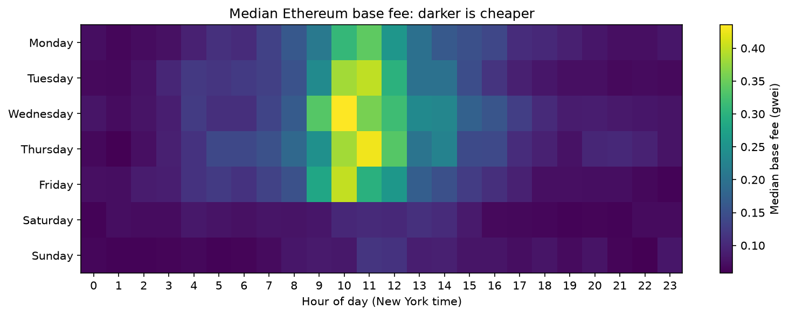
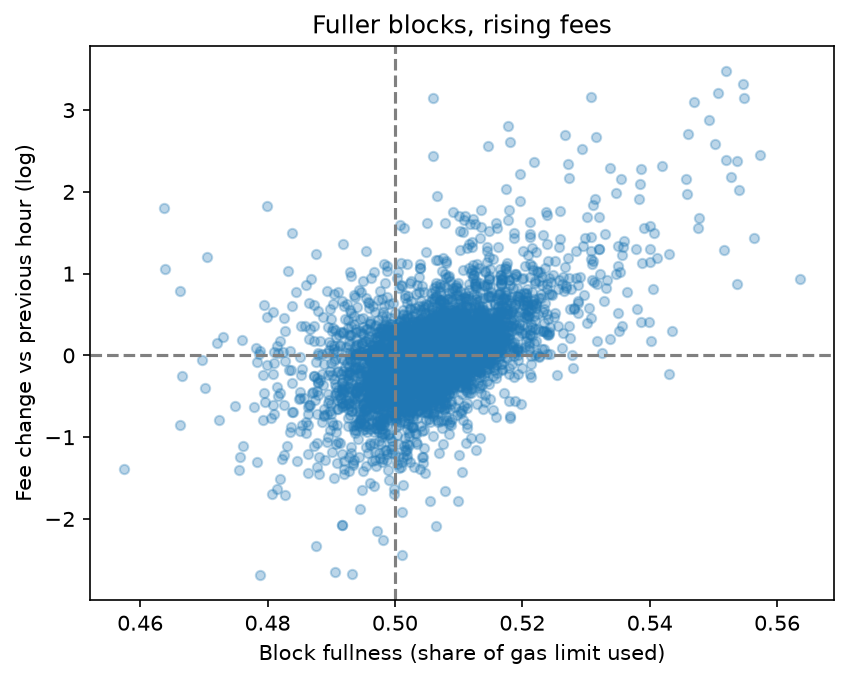

# Ethereum Gas Fee Study

## The question
When is the cheapest time to send a transaction on Ethereum, how much could a company save by timing it, and what causes fee spikes?

## The answer
Fees were lowest on **Sunday around 10pm** New York time and highest on **weekday mornings (9am to 1pm)**, peaking on Wednesday at 10am. The peak was about **7.5 times more expensive** than the cheapest slot. Weekends were about 35% cheaper than weekdays.

In 2026 fees are so low that timing barely matters for simple transfers: moving 100 transfers a month to off-peak hours saves only about **$1.82**, since a transfer costs a fraction of a cent either way. At scale it adds up: for 1,000 token swaps a month, the same timing saves about **$130 a month**.

The biggest spikes lined up with **market crashes**. The selloffs on Jan 31 and Feb 5, 2026 produced 6 of the 10 most expensive hours, when panic selling and liquidations filled blocks and the base fee climbed automatically.

**Rule for a company:** send non-urgent transactions on evenings or weekends, avoid weekday mornings in New York, and hold off during market crashes.



## How I did it
1. Wrote SQL in BigQuery on Google's public Ethereum dataset to summarize 9 months of blocks (Jan to Sep 2026) by hour ([query](sql/hourly_gas.sql))
2. Checked the data: 6,552 hours (every hour, no gaps), a median of 299 blocks per hour, and no missing values
3. Built a weekday by hour heatmap using **median** fees, because rare spikes push the mean (0.27 gwei) to more than double the median (0.11 gwei)
4. Tested the base fee rule. Block fullness has almost no link to the fee **level** (correlation 0.02), because the protocol adjusts the fee until blocks are back near half full. But fullness strongly predicts the fee's **direction** (correlation 0.53): when blocks were over 50% full the fee rose about 5% the next hour, and when they were under 50% it fell about 25%
5. Traced the 10 biggest spikes to real market events using news reports, and marked the ones I couldn't explain as unknown
6. Converted fees to dollars using daily ETH prices from Yahoo Finance



Full analysis: [notebooks/01_gas_analysis.ipynb](notebooks/01_gas_analysis.ipynb)

## Data and tools
Google BigQuery (`bigquery-public-data.crypto_ethereum`) · SQL · Python (pandas, Matplotlib) · Yahoo Finance (yfinance)

To rerun the notebook:

```bash
python3 -m venv .venv
source .venv/bin/activate
pip install -r requirements.txt
jupyter notebook notebooks/01_gas_analysis.ipynb
```

## Limits
- Uses the base fee only; real transactions also include a small priority tip
- Covers Jan to Sep 2026; patterns can shift as network usage changes
- Dollar costs are for simple transfers (21,000 gas); complex transactions cost more (the swap estimate assumes about 150,000 gas)
- Hourly averages smooth out spikes within an hour, so individual blocks were sometimes more expensive than shown
- Causes of 3 of the 5 spike days are uncertain or unknown
